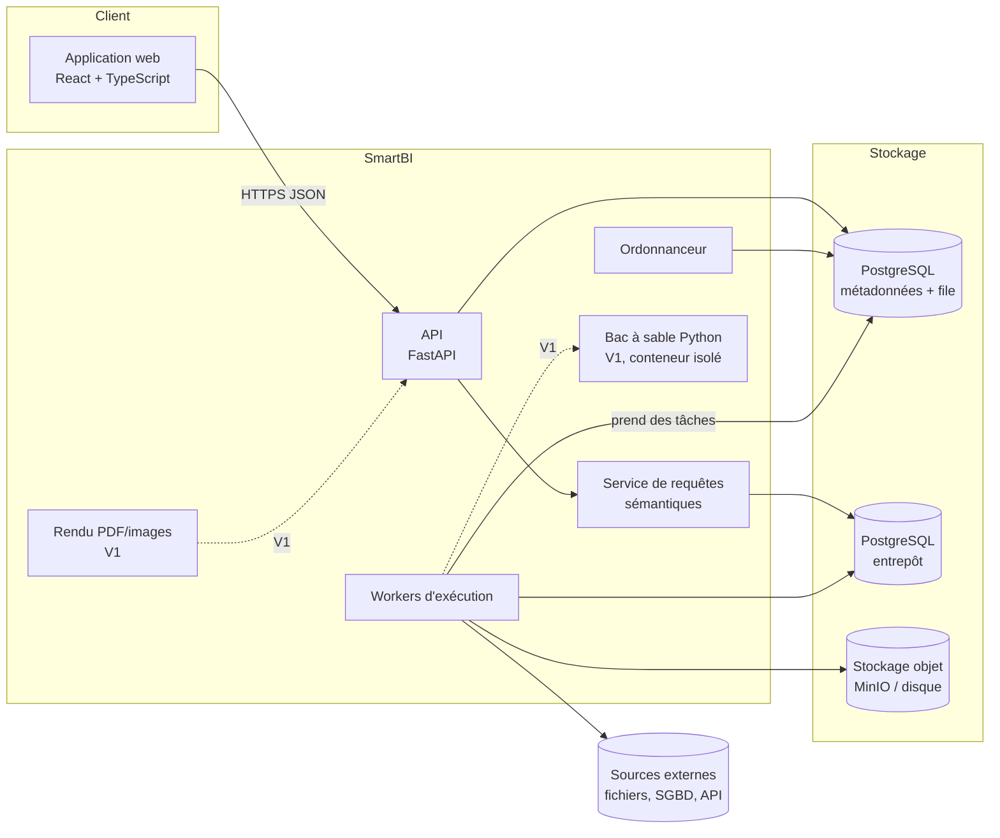
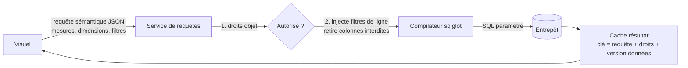
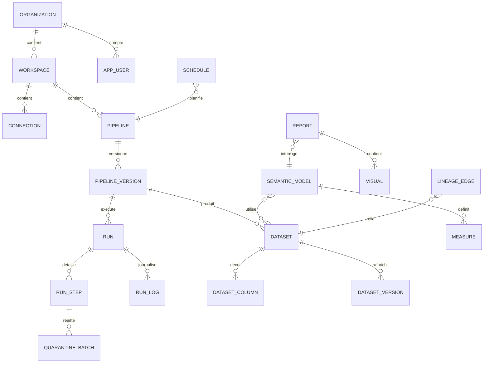

# SmartBI — Dossier d'analyse et de conception

> **Statut du document** : conception uniquement. **Aucune ligne de code n'a été écrite, aucun test n'a été exécuté, aucune mesure de performance n'a été réalisée.** Toutes les fonctionnalités décrites ici sont **prévues**, aucune n'est **implémentée**.
> Date : 2026-11-20 — Version 0.1 (proposition à valider).

Légende utilisée dans tout le document :

| Marqueur | Signification |
|---|---|
| **[MVP]** | Prévu dans la première version livrable (tranche de bout en bout) |
| **[V1]** | Prévu dans la première version commerciale |
| **[V2+]** | Évolution ultérieure |
| **[EXT]** | Dépend d'un service ou d'un contrat externe non maîtrisé (SMTP, fournisseur OIDC, API SmartRH…) |

---

## 0. Analyse critique de l'idée et hypothèses

### 0.1 Ce que l'idée demande réellement

L'idée regroupe en réalité **quatre produits** qui, sur le marché, sont souvent vendus séparément :

1. Un **outil d'intégration de données** (connecteurs, extraction, chargement, incrémental, idempotence).
2. Un **moteur de transformation** avec studio visuel (le cœur « ETL »).
3. Une **couche de modélisation et de gouvernance** (entrepôt, modèle en étoile, couche sémantique, catalogue, traçabilité, qualité).
4. Un **outil de restitution** (rapports, tableaux de bord, partage, diffusion).

C'est cohérent comme vision, mais c'est le principal risque du projet : **le périmètre est celui de plusieurs années-équipe**. La conception doit donc :

- fixer une **architecture qui accepte toute la vision** sans la construire d'un coup ;
- livrer d'abord **une tranche verticale qui fonctionne réellement** sur toute la chaîne, plutôt que neuf modules à moitié faits ;
- refuser les éléments décoratifs : un bloc du studio n'existe que si le moteur sait l'exécuter, le tester et en compter les lignes.

### 0.2 Points forts de l'idée

- Positionnement autonome vis-à-vis de SmartRH/SmartCompta/SmartStock : évite le piège du « tableau de bord maison ».
- Exigences d'ingénierie sérieuses (idempotence, quarantaine, traçabilité, sandbox) : elles différencient d'un simple outil de reporting.
- Marché initial précis (Congo-Brazzaville) avec architecture internationale : bon équilibre si la localisation est traitée comme une donnée de configuration, pas comme du code.

### 0.3 Tensions et risques identifiés

| Risque | Conséquence | Réponse proposée |
|---|---|---|
| Périmètre très large | Produit jamais terminé, modules superficiels | Découpage strict MVP / V1 / V2 (§9), critères d'acceptation vérifiables (§10) |
| Studio visuel trop puissant trop tôt | Blocs non fiables | Catalogue de blocs restreint au MVP, chaque bloc avec tests « golden » |
| Exécution SQL/Python utilisateur | Faille de sécurité, fuite inter-organisations | SQL restreint au MVP dans un moteur isolé ; Python seulement en V1 dans un bac à sable dédié |
| Infrastructure clients variable (serveurs modestes, coupures réseau/électriques) | Traitements interrompus, données incohérentes | Reprise par points de contrôle, chargements transactionnels, profils de ressources « petit / moyen / grand » |
| API SmartRH/SmartCompta/SmartStock non spécifiées | Connecteurs impossibles à tester | Traitées comme **[EXT]** : connecteur développé uniquement quand un contrat d'API versionné et un environnement de test existent |
| Multi-organisation | Fuite de données entre clients | Isolation à plusieurs niveaux (§8.3), tests automatisés dédiés |
| Promesses de performance | Perte de crédibilité | Objectifs exprimés avec matériel, volumes et protocole de mesure (§4.8) |

### 0.4 Hypothèses de travail (à valider)

| # | Hypothèse | Impact si fausse |
|---|---|---|
| H1 | Équipe initiale de 3 à 5 développeurs, compétences Python et TypeScript | Revoir le calendrier, pas l'architecture |
| H2 | Les clients cibles du MVP ont un serveur Linux (ou une VM) capable d'exécuter Docker, ≥ 4 vCPU, ≥ 16 Go RAM, SSD | Prévoir un profil « très petit » ou une offre hébergée |
| H3 | PostgreSQL ≥ 14 est acceptable comme entrepôt par défaut | Ajouter plus tôt un connecteur de destination alternatif |
| H4 | Volumes typiques du marché initial : de 10⁴ à 10⁷ lignes par table, quelques dizaines de Go au total par organisation | Au-delà, prévoir un moteur colonne dédié (V2+) |
| H5 | SmartRH, SmartCompta et SmartStock exposent (ou exposeront) une API HTTP documentée | Sinon, connexion via leur base SQL en lecture seule |
| H6 | Le navigateur client a accès au serveur SmartBI (LAN ou Internet) ; pas d'usage déconnecté du navigateur | Voir §8.7 pour le périmètre hors ligne |
| H7 | Conformité : la réglementation congolaise sur les données personnelles s'applique (loi relative à la protection des données à caractère personnel — **référence exacte et obligations à confirmer par un juriste**) | Fonctions de conservation/suppression/audit à ajuster |
| H8 | Le français est la seule langue livrée au MVP ; l'anglais en V1 | Aucun impact architectural (i18n dès le départ) |

### 0.5 Questions ouvertes à trancher avec vous

1. Offre **hébergée (SaaS)**, **installée chez le client**, ou les deux dès le MVP ? (La conception supporte les deux ; la priorité change l'ordre des travaux.)
2. Les API des logiciels Smart* existent-elles déjà ? Si oui, où est leur documentation ?
3. Quel volume de données réel chez les 2–3 premiers clients pilotes ?
4. Faut-il une authentification unique (OIDC/Active Directory) dès le MVP ?
5. Licence et modèle commercial (impacte le choix de dépendances open source : MIT/Apache uniquement est recommandé).

---

## 1. Vision du produit et périmètre

### 1.1 Vision

**SmartBI est une plateforme de données de bout en bout** permettant à une organisation, quel que soit son secteur ou son pays, de connecter ses sources, de construire des traitements de données fiables et traçables, de les stocker dans un modèle cohérent, puis d'en tirer des indicateurs partagés et sécurisés.

Phrase de positionnement : *« De la source au rapport, chaque chiffre est traçable. »*

### 1.2 Ce que SmartBI est / n'est pas

| SmartBI est | SmartBI n'est pas |
|---|---|
| Un outil d'intégration et de transformation de données | Un module de reporting de SmartRH/SmartCompta/SmartStock |
| Un entrepôt et une couche sémantique gouvernés | Un outil limité aux données RH, comptables ou congolaises |
| Un outil de rapports et tableaux de bord | Un outil de streaming temps réel (les actualisations sont périodiques ou à la demande) |
| Utilisable en installation locale ou dans le cloud | Une application hors ligne côté navigateur |

### 1.3 Distinction des concepts (à refléter dans l'interface et le code)

| Concept | Définition dans SmartBI |
|---|---|
| **Extraction** | Lecture des données d'une source, complète ou incrémentale |
| **ETL** | Transformations exécutées par le moteur SmartBI *avant* chargement |
| **ELT** | Données brutes chargées dans la destination, transformations exécutées *dans* la destination en SQL (si elle le permet) |
| **Stockage** | Zones brute / préparée / exploitable (§4.4) |
| **Modèle sémantique** | Définition centralisée des mesures, dimensions, relations, hiérarchies, calendriers |
| **Visualisation** | Rendu d'une requête sémantique dans un visuel |
| **Exécution de pipeline** | Lancement d'une version publiée d'un pipeline |
| **Rafraîchissement d'un jeu de données** | Résultat d'une exécution réussie : nouvelle version de données disponible |
| **Actualisation d'un visuel** | Nouvelle requête vers l'entrepôt (éventuellement servie depuis le cache) |

### 1.4 Profils utilisateurs

| Rôle | Responsabilités |
|---|---|
| **Administrateur** | Organisation, utilisateurs, rôles, espaces, paramètres régionaux, sauvegardes, audit |
| **Ingénieur données** | Connexions, pipelines, planifications, qualité, entrepôt, modèles |
| **Analyste** | Modèles sémantiques (mesures), rapports, tableaux de bord, partages |
| **Lecteur** | Consultation, filtres, exploration, exports autorisés, abonnements |

---

## 2. Parcours utilisateurs principaux

### P1 — Premier démarrage (administrateur) [MVP]
1. Installe via Docker Compose, ouvre l'URL, crée le compte administrateur initial (jeton à usage unique affiché dans les journaux d'installation).
2. Paramètre l'organisation : langue (fr), fuseau par défaut (ex. `Africa/Brazzaville`), devise par défaut (ex. `XAF`), formats.
3. Crée un espace de travail et invite des utilisateurs avec un rôle.

### P2 — Brancher une source (ingénieur données) [MVP]
1. *Connexions → Nouvelle connexion* → choisit « PostgreSQL ».
2. Saisit hôte, port, base, utilisateur, mot de passe (chiffré, jamais réaffiché), SSL.
3. *Tester* → résultat explicite (succès, latence, version serveur ; ou erreur classée : DNS, refus, authentification, SSL, délai).
4. *Explorer* → schémas → tables → colonnes et types → *Aperçu* (100 lignes par défaut).
5. Variante fichier : téléversement d'un CSV → détection encodage, séparateur, en-tête, types → correction manuelle possible → aperçu.

### P3 — Construire et exécuter un pipeline (ingénieur données) [MVP]
1. *Studio ETL → Nouveau pipeline* (brouillon).
2. Glisse « Source CSV » et « Source table PostgreSQL ».
3. Ajoute « Nettoyer » (types, valeurs nulles, espaces, formats de date) sur le CSV → aperçu avant/après, nombre de lignes rejetées.
4. Ajoute « Jointure » (gauche, clé `code_client`) → aperçu, alerte de cardinalité si la clé n'est pas unique côté droit.
5. Ajoute « Destination PostgreSQL » → table `ventes_clients`, mode *mise à jour/insertion*, clé `id_vente`, politique de schéma « échouer si changement ».
6. *Valider* → liste des erreurs de configuration par bloc.
7. *Publier* → version immuable v1.
8. *Exécuter* → suivi en direct par bloc : état, lignes entrées/sorties/rejetées, durée.
9. *Exécutions* → historique, journaux, lignes en quarantaine téléchargeables.

### P4 — Définir un indicateur et un rapport (analyste) [MVP]
1. *Modèles → Nouveau modèle* → ajoute le jeu de données `ventes_clients`.
2. Définit la mesure « Chiffre d'affaires » = `SUM(montant)`, format monétaire selon la colonne devise ou la devise du modèle.
3. *Rapports → Nouveau* → indicateur clé « Chiffre d'affaires », graphique en barres par région, tableau détaillé.
4. Ajoute un filtre global « Période » et « Région ». Sauvegarde.
5. Un lecteur ouvre le rapport, filtre, voit les chiffres limités à ses droits.

### P5 — Diagnostiquer un échec (ingénieur données) [MVP]
1. Notification d'échec (dans l'application au MVP, courriel en V1 **[EXT : SMTP]**).
2. Ouvre l'exécution → le bloc en échec est surligné, message clair + piste de correction (ex. « La colonne `date_vente` contient 312 valeurs non reconnues au format JJ/MM/AAAA. Exemple : `2024-13-01`. Vérifiez le format ou activez la quarantaine. »).
3. Corrige dans un nouveau brouillon, publie v2, relance. **La relance ne crée pas de doublon** (§3.3).

### P6 — Analyse d'impact (ingénieur données) [V1]
Avant de renommer une colonne source, ouvre la fiche du champ → voit les pipelines, jeux de données, mesures et rapports qui en dépendent.

### P7 — Diffusion programmée (analyste) [V1]
Programme l'envoi PDF hebdomadaire d'un rapport à une liste ; chaque destinataire reçoit **sa** version, calculée avec **ses** droits ; un destinataire sans compte ne reçoit rien (ou un lien soumis à authentification).

### P8 — Supervision sur tablette (responsable) [V1]
Consulte l'accueil : exécutions du jour, échecs, fraîcheur des jeux de données, alertes qualité ; relance une exécution autorisée.

---

## 3. Spécifications fonctionnelles par module

### 3.1 Connexions

**Architecture extensible** : chaque connecteur implémente une interface commune (voir §4.5) et déclare ses **capacités** (`test`, `browse`, `preview`, `read_full`, `read_incremental`, `write_append`, `write_upsert`, `write_replace`, `pushdown_sql`). L'interface n'affiche que les options des capacités déclarées — **aucun connecteur n'apparaît comme disponible s'il n'est pas implémenté et testé** ; les connecteurs prévus apparaissent dans une liste « Prochainement » clairement distincte, ou pas du tout.

| Connecteur | Lecture | Écriture | Version |
|---|---|---|---|
| CSV (téléversement) | ✔ | export | **[MVP]** |
| PostgreSQL | ✔ | ✔ | **[MVP]** |
| Excel (.xlsx) | ✔ | export | [V1] |
| JSON / JSON Lines | ✔ | export | [V1] |
| Parquet | ✔ | export | [V1] |
| SQLite | ✔ | — | [V1] |
| MySQL / MariaDB | ✔ | ✔ | [V1] |
| SQL Server | ✔ | ✔ | [V1] |
| Dossier local / réseau monté | ✔ | ✔ | [V1] |
| Stockage compatible S3 | ✔ | ✔ | [V1] **[EXT]** pour les fournisseurs tiers |
| API REST générique (auth clé/Bearer/Basic/OAuth2 client credentials ; pagination offset/page/curseur/lien) | ✔ | — | [V1] |
| SmartRH / SmartCompta / SmartStock | ✔ | — | [V1] **[EXT]** : conditionné à un contrat d'API |
| Excel .xls (ancien format), Oracle, ClickHouse, Google Sheets… | — | — | [V2+] |

Fonctions communes à toute connexion :
- **Tester** : opération bornée par un délai, erreurs classées (réseau, DNS, authentification, autorisation, TLS, délai, version non supportée).
- **Explorer** : schémas/tables/colonnes ou fichiers/feuilles/champs, paginé.
- **Aperçu** : échantillon borné (N lignes, taille max en Mo), jamais de lecture complète.
- **Détection des types** : sur échantillon, avec score de confiance ; types SmartBI : `string, integer, decimal(p,s), float, boolean, date, timestamp, timestamp_tz, time, json, binary`. L'utilisateur peut forcer un type.
- **Paramètres régionaux par source** : encodage, séparateur décimal, séparateur de milliers, format de date, fuseau horaire de la source, devise par défaut. **Aucune valeur n'est imposée globalement** ; la valeur d'organisation n'est qu'un défaut pré-rempli.
- **Secrets** : stockés chiffrés (§8.4), jamais renvoyés au navigateur (champ affiché « •••• défini »), jamais écrits dans les journaux (masquage automatique).
- **Fiabilité** : délai de connexion, délai de requête, taille de lot, nombre de tentatives, temporisation exponentielle avec gigue, limite de débit pour les API.

### 3.2 Studio ETL visuel

#### Modèle d'un pipeline
Un pipeline est un **graphe orienté acyclique** de blocs typés. Chaque arête transporte un **schéma connu** (liste de colonnes typées), propagé à la validation. Le graphe est stocké sous forme de document JSON versionné (exemple §7.4).

#### Catalogue de blocs

| Famille | Blocs | Version |
|---|---|---|
| Sources | Fichier téléversé (CSV), Table/requête SQL | **[MVP]** |
| Colonnes | Sélectionner / supprimer / renommer / réordonner | **[MVP]** |
| Types | Convertir type, harmoniser format (dates, nombres, casse, espaces) | **[MVP]** |
| Lignes | Filtrer (constructeur de conditions), trier, dédoublonner (sur clés, avec règle « garder premier/dernier selon colonne ») | **[MVP]** |
| Qualité | Valeurs nulles (remplacer, rejeter, laisser) ; validation de lignes avec envoi en quarantaine | **[MVP]** |
| Combinaison | Jointure (interne, gauche, droite, complète) | **[MVP]** |
| Combinaison | Union (par nom ou position), recherche de correspondance (lookup) | [V1] |
| Valeurs | Remplacer, découper, concaténer, extraire (regex) | [V1] (remplacer au MVP) |
| Calcul | Colonne calculée (langage d'expression SmartBI), règles conditionnelles (SI/ALORS) | **[MVP]** expression simple ; [V1] complet |
| Agrégation | Grouper/agréger | **[MVP]** |
| Restructuration | Pivoter, dépivoter | [V1] |
| SQL | Transformation SQL (SELECT uniquement, sur les entrées du bloc) | [V1] |
| Python | Script en bac à sable avec quotas | [V1] désactivé par défaut |
| Destinations | Table PostgreSQL | **[MVP]** |
| Destinations | Autres SGBD, exports CSV/Excel/Parquet | [V1] |

#### Exigences par bloc
Chaque bloc expose, de façon obligatoire (sinon il n'est pas livré) :
1. **Formulaire de configuration** généré depuis un schéma JSON + aide contextuelle en français.
2. **Validation statique** (sans données) : colonnes existantes, types compatibles, clés de jointure présentes, expression analysable.
3. **Aperçu avant/après** sur échantillon, avec un **avertissement explicite** : « Aperçu calculé sur un échantillon de N lignes ; les jointures et agrégations peuvent différer du résultat complet. »
4. **Compteurs** : lignes entrantes, sortantes, rejetées (aperçu et exécution réelle).
5. **Erreurs explicites** : code stable, message, bloc et colonne concernés, exemples de valeurs fautives (masquées si la colonne est marquée sensible), suggestion de correction.

#### Langage d'expression
Un mini-langage sûr (pas d'eval) : opérateurs arithmétiques/comparaison/logiques, fonctions (`SI`, `COALESCE`, `ARRONDI`, `MAJUSCULE`, `DATE_PART`, `CONCAT`…), noms en français avec alias anglais. Analysé côté serveur, compilé en SQL du moteur d'exécution. *Justification* : un langage maîtrisé est validable, traduisible en SQL et sans risque d'exécution arbitraire.

#### Cycle de vie
- **Brouillon** : modifiable, sauvegarde automatique, aperçus autorisés, **pas d'exécution planifiée** et pas d'écriture en destination de production.
- **Publié** : version immuable numérotée (v1, v2…), seule exécutable par planification.
- **En cours d'exécution** : état d'une *exécution*, pas du pipeline ; une version publiée peut avoir plusieurs exécutions historiques.
- Opérations : sauvegarder, dupliquer, comparer deux versions (diff JSON lisible) [V1], restaurer une version en brouillon, **exporter/importer** (fichier JSON signé par somme de contrôle, sans secrets ; les connexions sont référencées par nom et remappées à l'import) [MVP pour export/import simple].

### 3.3 Extraction et chargement

#### Modes d'extraction
- **Complète** [MVP].
- **Incrémentale par marqueur** [MVP] : colonne monotone (date de mise à jour ou identifiant croissant). Le marqueur est enregistré **uniquement après** le chargement réussi. Option de **fenêtre de recouvrement** (ex. relire les 2 dernières heures) pour les données arrivant en retard — sans risque de doublons grâce au mode mise à jour/insertion.
- **Incrémentale par curseur d'API** [V1] (pagination, jeton de reprise).
- Capture de changements (CDC) depuis les journaux de base : [V2+].

#### Modes de chargement et idempotence

| Mode | Mécanisme | Comportement en relance |
|---|---|---|
| **Remplacement** | Écriture dans une table de transit `_sbi_stage_<run>` puis, dans **une transaction**, échange (renommage) ou `TRUNCATE` + `INSERT … SELECT` | Résultat identique ; en cas d'échec avant le commit, la table cible reste intacte |
| **Ajout** | Chaque ligne porte `_sbi_load_id` (identifiant du lot logique = pipeline + partition source + marqueur). Dans une transaction : `DELETE WHERE _sbi_load_id = X` puis `INSERT` | La relance du même lot remplace le lot, **pas de doublons** |
| **Mise à jour/insertion** | Clés de correspondance obligatoires ; dédoublonnage du lot sur les clés (politique : erreur / garder dernier selon colonne) ; `INSERT … ON CONFLICT (clés) DO UPDATE` depuis la table de transit | Idempotent par construction |

Règles complémentaires :
- **Contrainte d'unicité** créée sur les clés de correspondance si absente (avec avertissement et confirmation si la table existe déjà avec des doublons — dans ce cas le chargement échoue avec un rapport des doublons, **jamais de suppression silencieuse**).
- **Marqueur et chargement dans la même transaction** : le marqueur incrémental est écrit dans une table de contrôle `_smartbi_state` *dans la base de destination*, dans la même transaction que les données ; la base de métadonnées en garde une copie informative. Ainsi un crash entre « données écrites » et « marqueur sauvé » est impossible.
- **Exécutions simultanées** d'un même pipeline vers une même cible : interdites par défaut (verrou consultatif PostgreSQL par cible) ; politique configurable : *mettre en file*, *ignorer*, *annuler la précédente*.

#### Changements de schéma (politique par destination)
| Politique | Nouvelle colonne source | Colonne disparue | Changement de type |
|---|---|---|---|
| Échouer (défaut) | échec | échec | échec |
| Ajouter | `ALTER TABLE ADD COLUMN` | colonne remplie à NULL + avertissement | échec |
| Ignorer | ignorée + avertissement | NULL + avertissement | conversion tentée, échecs → quarantaine |

Chaque changement détecté est journalisé et visible dans le catalogue.

#### Traitement par lots et mémoire
- Lecture en **flux de lots** (Arrow RecordBatch, taille configurable, ex. 50 000 lignes) ; jamais de chargement complet en mémoire côté worker.
- Le moteur de transformation (§4.3) travaille sur fichiers Parquet intermédiaires avec **limite mémoire** et débordement sur disque.
- Écriture en destination par `COPY` binaire/CSV en flux vers la table de transit.

#### ETL et ELT
- **ETL** (défaut) : transformations dans le moteur SmartBI.
- **ELT** [V1] : quand source et destination sont la même base PostgreSQL (ou quand l'utilisateur choisit « charger brut puis transformer »), le graphe compatible est **compilé en SQL exécuté dans la destination**. Le studio indique, bloc par bloc, où il s'exécutera (« dans SmartBI » / « dans la base »). Les blocs non compilables (Python) forcent le mode ETL.

#### Reprise après échec
- Granularité de reprise : **le pipeline est relancé depuis le début du lot logique** (simplicité, idempotence garantie par les modes ci-dessus).
- Les sorties intermédiaires de blocs (Parquet) sont conservées pendant une durée configurable ; [V1] reprise **à partir du dernier bloc réussi** si le hash de la configuration et des entrées est inchangé.
- Pour les extractions longues : points de contrôle par partition (ex. par jour ou par page d'API) [V1].

### 3.4 Orchestration et supervision

| Fonction | Détail | Version |
|---|---|---|
| Exécution manuelle | Avec paramètres optionnels | **[MVP]** |
| Planification | Expression cron + fuseau horaire **explicite** de la planification | **[MVP]** |
| Paramètres d'exécution | Variables typées (`date_debut`, `site`…) utilisables dans les blocs | [V1] |
| Dépendances | « Exécuter B après succès de A » ; graphe de tâches inter-pipelines | [V1] |
| Nouvelles tentatives | Nombre, délai, uniquement pour erreurs classées « transitoires » | **[MVP]** |
| Annulation | Coopérative (vérifiée entre lots) puis forcée après délai de grâce ; aucune écriture partielle grâce aux transactions | **[MVP]** |
| Délai maximal | Par exécution et par bloc ; état `timed_out` | **[MVP]** |
| Concurrence | Limite globale de workers + limite par organisation + politique par pipeline | **[MVP]** global ; [V1] par organisation |
| Historique, journaux, métriques | États, durées, lignes par bloc, mémoire max, journaux structurés | **[MVP]** |
| Notifications | Dans l'application **[MVP]** ; courriel **[V1][EXT : SMTP]** ; webhook [V1] ; SMS/WhatsApp [V2+][EXT] |

États d'une exécution : `queued → running → (succeeded | failed | cancelled | timed_out)`. Une exécution est toujours rattachée à **une version publiée**. Les aperçus de brouillon ne sont pas des exécutions.

### 3.5 Qualité et gouvernance

- **Contrôles** [MVP pour non-nul / unicité / format ; V1 pour le reste] : complétude (taux de non-null), unicité, format (regex, liste de valeurs), plage, cohérence inter-colonnes (expression), intégrité référentielle (clé présente dans une autre table), fraîcheur.
- **Seuils** : par contrôle, niveau *avertissement* ou *bloquant* (ex. « échouer si plus de 2 % de lignes rejetées »).
- **Quarantaine** [MVP] : chaque ligne rejetée est écrite (Parquet, stockage objet) avec : exécution, bloc, règle, colonne, valeur, message. Consultable, téléchargeable (droits vérifiés), purgée selon la politique de conservation. **Aucune ligne n'est supprimée silencieusement** : toute ligne absente de la sortie est soit filtrée par une règle explicite de l'utilisateur (comptée), soit en quarantaine.
- **Catalogue** [MVP minimal ; V1 complet] : jeux de données (tables produites), propriétaire, description, étiquettes, fraîcheur, schéma, qualité, sensibilité des colonnes.
- **Dictionnaire** [V1] : champs et indicateurs avec définition métier, unité, formule, propriétaire.
- **Traçabilité (lignage)** [MVP au niveau table ; V1 au niveau colonne] : dérivée automatiquement du graphe des pipelines publiés et des modèles sémantiques (pas de saisie manuelle).
- **Analyse d'impact** [V1] : parcours du graphe de lignage vers l'aval.
- **Conservation** [V1] : durées par type (journaux, quarantaine, sorties intermédiaires, exports, historique d'exécution, partitions de données datées), purge planifiée et journalisée.

### 3.6 Stockage et modélisation

- Zones **brute / préparée / exploitable** (§4.4).
- **Modèle en étoile** [V1 assistant ; MVP via tables simples] : déclaration des tables de faits et de dimensions, relations, cardinalités (1–1, 1–N ; N–N via table de liaison uniquement), direction de filtrage.
- **Dimensions historisées (SCD type 2)** [V1] : bloc de destination dédié gérant `valide_du`, `valide_au`, `est_courant` et clé de substitution.
- **Couche sémantique** [MVP minimal] :
  - jeux de données, relations ;
  - **mesures réutilisables** (agrégation + expression + filtre éventuel + format) ;
  - dimensions et **hiérarchies** (Année > Trimestre > Mois > Jour ; Pays > Région > Ville) [V1] ;
  - **calendrier** généré (table de dates avec exercice fiscal configurable, jours fériés importables) [V1] ;
  - règles d'agrégation (additive, semi-additive ex. stock = dernière valeur sur le temps, non additive ex. ratio recalculé) [V1] ;
  - **devises** : la mesure monétaire porte sa devise (colonne ou constante) ; aucune somme multi-devises sans table de taux explicite [V1].
- Tous les rapports passent par la couche sémantique : **une mesure = une définition**, d'où des résultats cohérents entre rapports.

### 3.7 Analyse et visualisation

| Fonction | Version |
|---|---|
| Indicateur clé (valeur, variation vs période précédente) | **[MVP]** (variation en V1) |
| Tableau, graphique barres/lignes/secteurs | **[MVP]** |
| Tableau croisé, aires, nuages de points, combinés, jauges | [V1] |
| Cartes (si colonnes géographiques typées ou géocodage disponible) | [V1] ; fonds de carte **[EXT]** ou tuiles auto-hébergées |
| Filtres globaux (page) et par visuel | **[MVP]** |
| Exploration du détail (drill-down hiérarchie, drill-through vers lignes) | [V1] |
| Comparaison entre périodes (N-1, période précédente, cumul) | [V1] |
| Mise en forme conditionnelle | [V1] |
| Sauvegarde, partage interne avec droits | **[MVP]** sauvegarde ; [V1] partage |
| Exports Excel/CSV des données d'un visuel | [V1] |
| Exports PDF / image | [V1] (rendu serveur par navigateur sans interface) |
| Diffusion programmée avec droits du destinataire | [V1][EXT : SMTP] |
| Tableaux de bord (assemblage de visuels de plusieurs rapports, grille responsive) | [V1] |

Fraîcheur affichée sur chaque rapport : « Données au 20/11/2026 14:05 (exécution #482) ». Jamais l'étiquette « temps réel ».

### 3.8 Administration
Organisation, paramètres régionaux, espaces, utilisateurs, groupes, rôles, droits, restrictions ligne/colonne, journal d'audit, quotas (exécutions simultanées, stockage), clés de chiffrement (rotation), sauvegardes, état du système (santé des services, file d'attente, espace disque).

### 3.9 Internationalisation
- Textes d'interface en fichiers de messages ICU (pluriels, genres) ; `fr` par défaut, `en` en V1.
- Formats via les API `Intl` du navigateur et Babel côté serveur (exports PDF/Excel).
- Toutes les dates stockées en UTC (`timestamptz`) **sauf** les dates métier sans heure (`date`) ; le fuseau d'origine est un paramètre de la source ; l'affichage suit la préférence de l'utilisateur.
- Montants : type décimal exact (jamais `float`), devise ISO 4217 associée ; XAF a 0 décimale par défaut (configurable).

---

## 4. Architecture technique justifiée

### 4.1 Vue d'ensemble



### 4.2 Choix techniques et justification

| Composant | Choix | Justification | Alternatives écartées |
|---|---|---|---|
| Langage serveur | **Python 3.12+** | Écosystème données le plus riche (Arrow, DuckDB, pilotes SGBD, sqlglot), même langage pour API, workers et bac à sable | Go/Java : plus performants en API mais écosystème données moins riche, deux langages côté serveur |
| API | **FastAPI** + Pydantic | Contrats typés, génération OpenAPI automatique (contrats §7 vérifiables), asynchrone | Django : plus lourd, ORM moins adapté aux schémas dynamiques |
| Moteur de transformation | **DuckDB** embarqué dans les workers, sur données **Apache Arrow/Parquet** | Exécution colonne vectorisée, **limite mémoire et débordement sur disque** (respecte « ne pas tout charger en mémoire »), lit/écrit Parquet/CSV en flux, SQL standard, licence MIT, aucun serveur à exploiter | pandas : tout en mémoire. Spark : surdimensionné pour H4 et coûteux à exploiter on-premise |
| Compilation du graphe | **sqlglot** | Un bloc = un fragment SQL ; sqlglot permet de générer et transpiler vers DuckDB (ETL) **ou** PostgreSQL (ELT) et d'analyser le SQL utilisateur (n'autoriser que `SELECT`) | Génération de chaînes SQL : fragile et dangereuse |
| Base de métadonnées | **PostgreSQL** | Transactions, RLS native pour l'isolation, JSONB pour les définitions de pipelines | — |
| File de tâches | **Table PostgreSQL + `SELECT … FOR UPDATE SKIP LOCKED`** | Un composant de moins (pas de Redis/RabbitMQ) ; l'état d'une exécution et sa mise en file sont dans la **même transaction** → pas d'exécution « perdue » ou dupliquée | Celery+Redis : un service de plus, cohérence état/file plus difficile. Peut être ajouté en V2+ si le débit l'exige |
| Ordonnanceur | Processus dédié, unique actif (verrou consultatif), **insertion idempotente** `(schedule_id, scheduled_for)` unique | Une planification ne crée jamais deux exécutions, même si deux ordonnanceurs démarrent | cron système : pas de visibilité ni d'idempotence |
| Entrepôt par défaut | **PostgreSQL** (instance ou base séparée de la métadonnée) | Connu des équipes locales, transactionnel, `ON CONFLICT` pour l'upsert, suffisant pour H4 avec index et tables agrégées | ClickHouse/DuckDB serveur : à proposer en V2+ comme destination pour gros volumes |
| Stockage objet | **MinIO** (S3) ou système de fichiers local selon profil | Zone brute, fichiers téléversés, quarantaine, sorties intermédiaires, exports ; interface S3 identique en local et cloud | — |
| Front-end | **React + TypeScript + Vite** | Écosystème, typage | — |
| Éditeur de graphe | **React Flow (xyflow)**, licence MIT | Glisser-déposer, nœuds personnalisés, accessibilité clavier à compléter par nos soins | Développement maison : coût élevé |
| Graphiques | **Apache ECharts** | Riche (cartes, tableaux croisés possibles), licence Apache 2.0, rendu canvas performant | — |
| Tableaux | TanStack Table + virtualisation | Grands tableaux fluides | — |
| Formulaires de blocs | Générés depuis JSON Schema publiés par l'API | Un seul schéma de vérité front/back | — |
| i18n | FormatJS (ICU) côté client, Babel côté serveur | Pluriels/formats corrects | — |
| Rendu PDF/images | Chromium sans interface, service séparé [V1] | Rapport rendu identique à l'écran | Bibliothèque PDF dédiée : double implémentation des visuels |
| Bac à sable Python | Conteneur éphémère sans réseau, système de fichiers en lecture seule sauf `/work`, limites CPU/mémoire/temps (cgroups), utilisateur non privilégié, profil seccomp ; **gVisor** si disponible [V1] | Exécution de code arbitraire = surface d'attaque maximale ; l'isolation par conteneur dédié est le minimum acceptable | Exécution dans le worker : inacceptable |

**Interface visuelle** : identité propre (vert profond, surfaces claires), composants accessibles (Radix UI ou équivalent sans style imposé) ; aucune reprise de l'interface d'un logiciel existant.

### 4.3 Fonctionnement du moteur d'exécution

```mermaid
sequenceDiagram
  participant S as Ordonnanceur / API
  participant Q as File (PostgreSQL)
  participant W as Worker
  participant SRC as Source
  participant O as Stockage objet
  participant D as DuckDB (local au worker)
  participant WH as Entrepôt PostgreSQL

  S->>Q: INSERT run (queued) — transaction
  W->>Q: SELECT … FOR UPDATE SKIP LOCKED → running
  W->>SRC: lecture en flux (lots Arrow)
  W->>O: écriture Parquet zone brute (par lot)
  W->>D: exécution du plan SQL compilé (limite mémoire, spill disque)
  D-->>O: Parquet zone préparée + rejets (quarantaine)
  W->>W: contrôles qualité / seuils
  W->>WH: COPY en flux → table de transit
  W->>WH: BEGIN; merge/échange; maj _smartbi_state; COMMIT
  W->>Q: run succeeded + métriques
```

Points clés :
1. **Compilation** : le graphe publié est validé (schémas propagés), chaque bloc devient une vue SQL ; les rejets sont produits par des requêtes complémentaires (lignes ne passant pas la règle) — ainsi `entrées = sorties + rejets + filtrées` est vérifiable bloc par bloc.
2. **Matérialisation** : les blocs coûteux ou consultés en aperçu sont matérialisés en Parquet ; les autres sont fusionnés par l'optimiseur.
3. **Ressources** : DuckDB configuré avec `memory_limit`, `threads`, `temp_directory` selon le profil (§4.7), accès externe désactivé sauf aux chemins de l'exécution.
4. **Heartbeat** : le worker met à jour `heartbeat_at` ; une exécution sans heartbeat depuis X minutes est déclarée `failed (worker_lost)` puis relancée selon la politique — sans risque grâce à l'idempotence du chargement.

### 4.4 Zones de données

| Zone | Contenu | Emplacement | Justification |
|---|---|---|---|
| **Brute** | Copie fidèle de l'extraction, partitionnée par source/date d'exécution | Stockage objet, Parquet | Rejouabilité sans réinterroger la source, audit, débogage |
| **Préparée** | Données nettoyées, typées, conformes | Stockage objet (Parquet) **ou** schéma `prep_*` de l'entrepôt | Sorties intermédiaires réutilisables |
| **Exploitable** | Faits, dimensions, agrégats destinés aux rapports | Entrepôt, schéma `mart_*` | Interrogé par la couche sémantique |

La conservation de la zone brute est configurable (elle peut être désactivée pour des données personnelles sensibles).

### 4.5 Interface des connecteurs (contrat interne)

```
Connector
  capabilities() -> set[Capability]
  config_schema() -> JSONSchema          # champs publics et champs secrets
  test(config, secrets) -> TestResult
  browse(config, secrets, path, page) -> list[Entry]
  preview(config, secrets, object, limit, max_bytes) -> ArrowTable
  infer_schema(...) -> Schema(+confiance)
  read(config, secrets, object, mode, watermark?) -> Iterator[RecordBatch]
  write(...)  # si capacité d'écriture : vers table de transit + merge transactionnel
```
Chaque connecteur est livré avec une **suite de tests de conformité commune** exécutée contre un vrai service en conteneur (PostgreSQL, MySQL, MinIO, serveur HTTP simulé pour l'API REST). Un connecteur qui ne passe pas la suite n'est pas activable.

### 4.6 Couche sémantique et requêtes


- Le navigateur n'envoie **jamais de SQL** ; seulement une requête sémantique.
- Délai maximal et limite de lignes par requête ; pagination pour les tableaux.
- Le cache est invalidé par la **version de données** (incrémentée à chaque chargement réussi du jeu de données) et partitionné par **empreinte des droits** de l'utilisateur.

### 4.7 Déploiement

**Docker Compose** (installation reproductible, une commande, fichier `.env` documenté) :

| Service | Rôle | Réplicable |
|---|---|---|
| `web` | Fichiers statiques du front + reverse proxy (Caddy ou Nginx, TLS) | oui |
| `api` | API REST | oui |
| `worker` | Exécutions de pipelines | oui (N) |
| `scheduler` | Planifications | 1 actif (verrou) |
| `metadb` | PostgreSQL métadonnées | — |
| `warehouse` | PostgreSQL entrepôt (optionnel si entrepôt client existant) | — |
| `objectstore` | MinIO (optionnel : disque local en profil « petit ») | — |
| `sandbox-runner` [V1] | Lanceur de conteneurs Python isolés | — |
| `renderer` [V1] | Chromium sans interface | — |

Profils de ressources (paramètres pré-calculés, ajustables) :

| Profil | Matériel indicatif | Workers | Mémoire DuckDB / worker |
|---|---|---|---|
| Petit | 4 vCPU, 16 Go | 1 | 4 Go |
| Moyen | 8 vCPU, 32 Go | 2 | 8 Go |
| Grand | 16+ vCPU, 64 Go+ | 4+ | 12 Go |

Cloud : mêmes images ; base managée PostgreSQL, stockage S3, orchestration Kubernetes possible en V2+ (charts Helm) — non requis au MVP.

### 4.8 Objectifs de performance (à mesurer — aucune mesure réalisée)

Protocole : jeu de données synthétique généré par un script versionné ; machine de référence = profil **Petit** (4 vCPU, 16 Go RAM, SSD NVMe, PostgreSQL 16 sur la même machine) ; mesures répétées 5 fois, médiane publiée avec la version du logiciel.

| Scénario | Volume | Objectif cible | Contrainte |
|---|---|---|---|
| Pipeline tranche MVP (CSV + table PG, nettoyage, jointure, upsert PG) | CSV 5 M lignes × 20 colonnes (~1 Go) ; table de référence 100 000 lignes | < 10 min | Mémoire résidente du worker < 6 Go |
| Même pipeline, relance sans changement | idem | < 10 min, **0 ligne ajoutée** | — |
| Aperçu d'un bloc | échantillon 1 000 lignes | < 3 s | — |
| Requête d'un visuel (agrégat sur table de faits indexée) | 10 M lignes | p95 < 3 s sans cache, < 300 ms avec cache | — |
| Chargement de l'accueil | — | < 2 s sur réseau 10 Mbit/s | — |

Ces valeurs sont des **objectifs de conception** ; ils deviennent des engagements seulement après mesure publiée.

---

## 5. Modèle de données interne (base de métadonnées)

Toutes les tables portent `org_id` (sauf `organization`), `created_at`, `created_by`, `updated_at`. RLS PostgreSQL activée sur `org_id`.



| Table | Colonnes principales | Remarques |
|---|---|---|
| `organization` | id, nom, locale, fuseau, devise_defaut, formats (JSONB), statut | |
| `app_user` | id, org_id, email, nom, hash_mdp (argon2id), mfa_secret_chiffré, locale, fuseau, statut, dernier_acces | |
| `user_group`, `group_member` | | |
| `role_binding` | principal (user/group), rôle, portée (org / espace / objet), objet_type, objet_id | Droits par espace, connexion, pipeline, jeu de données, rapport |
| `workspace` | id, org_id, nom, description | |
| `connection` | id, workspace_id, type, nom, config_publique (JSONB), secret_ref, paramètres_régionaux, délais/tentatives, dernier_test (état, date) | Jamais de secret en clair |
| `secret` | id, org_id, ciphertext, nonce, dek_chiffrée, version_clé, créé/rotation | Chiffrement par enveloppe |
| `uploaded_file` | id, workspace_id, chemin_objet, taille, sha256, détection (encodage, séparateur…) | |
| `pipeline` | id, workspace_id, nom, statut (brouillon/archivé), brouillon (JSONB), version_publiée_courante | |
| `pipeline_version` | id, pipeline_id, numéro, définition (JSONB, immuable), hash, publié_par, publié_le, note | |
| `schedule` | id, pipeline_id, cron, fuseau, paramètres, actif, politique_concurrence, prochaine_execution | |
| `run` | id, pipeline_version_id, déclencheur (manuel/planif/dépendance), schedule_id, scheduled_for, paramètres, état, tentative, worker_id, heartbeat_at, début, fin, erreur_code, erreur_message, métriques (JSONB), annulation_demandée | Unique (schedule_id, scheduled_for) |
| `run_step` | id, run_id, node_id, état, lignes_in, lignes_out, lignes_rejet, lignes_filtrées, durée, mémoire_max, erreur | |
| `run_log` | id, run_id, step_id, niveau, horodatage, code, message, contexte (JSONB masqué) | Partitionnée par mois |
| `quarantine_batch` | id, run_step_id, chemin_objet, nb_lignes, règles (JSONB), expire_le | |
| `quality_rule` | id, dataset_id ou node, type, paramètres, seuil, sévérité | |
| `quality_result` | id, run_id, rule_id, valeur, statut | |
| `dataset` | id, workspace_id, connexion_destination, schéma, table, zone, propriétaire, description, sensibilité, version_données_courante | |
| `dataset_column` | id, dataset_id, nom, type, description, sensible, étiquettes | |
| `dataset_version` | id, dataset_id, run_id, numéro, nb_lignes, chargé_le | Sert à l'invalidation du cache et à la fraîcheur |
| `lineage_edge` | source_type/id/colonne, cible_type/id/colonne, via (pipeline_version/node ou mesure) | Généré automatiquement |
| `semantic_model` | id, workspace_id, nom, définition (JSONB : jeux, relations, dimensions, hiérarchies), version | |
| `measure` | id, model_id, nom, expression, agrégation, type_additivité, format, devise, description | |
| `row_policy` | id, dataset_id ou model_id, principal, expression_filtre | Ex. `region = {user.attr.region}` |
| `column_policy` | id, dataset_id, colonne, principal, action (masquer/interdire) | |
| `report` | id, workspace_id, model_id, nom, mise_en_page (JSONB), filtres_globaux, version | |
| `visual` | id, report_id, type, requête_sémantique (JSONB), options | |
| `dashboard` [V1], `subscription` [V1], `notification` | | |
| `job_queue` | id, type, payload, état, priorité, disponible_le, verrou_par, tentatives | File PostgreSQL |
| `audit_event` | id, org_id, acteur, action, objet, avant/après (diff masqué), ip, horodatage, hash_chaîné | Ajout seul ; chaînage pour détecter les altérations |
| `retention_policy` | id, org_id, catégorie, durée | |

**Dans chaque base de destination** : table de contrôle `_smartbi_state(pipeline_id, cible, watermark, load_id, run_id, updated_at)` et colonnes techniques optionnelles `_sbi_load_id`, `_sbi_loaded_at`, `_sbi_run_id` sur les tables chargées.

---

## 6. Écrans et interactions

Navigation latérale (repliable sur tablette) : **Accueil · Connexions · Studio ETL · Exécutions · Catalogue · Modèles · Rapports · Tableaux de bord · Administration**. Sélecteur d'espace de travail en tête. Les entrées non disponibles dans la version installée **n'apparaissent pas** (pas de menu vide présenté comme fonctionnel).

| Écran | Contenu | Interactions clés | Tablette |
|---|---|---|---|
| **Accueil** | Exécutions récentes et échecs, fraîcheur des jeux de données, alertes qualité, raccourcis | Relancer (si droit), ouvrir l'exécution | Optimisé |
| **Connexions – liste** | Type, état du dernier test, propriétaire, utilisation | Filtrer, tester, dupliquer | Oui |
| **Connexion – assistant** | Étapes : type → paramètres → secrets → paramètres régionaux → test → exploration | Test en direct, erreurs classées | Consultation |
| **Explorateur de source** | Arbre schémas/tables/fichiers ; panneau colonnes/types ; aperçu | Forcer un type, créer un pipeline depuis cet objet | Consultation |
| **Studio ETL** | Palette de blocs (gauche), canevas (centre), panneau de configuration (droite), panneau d'aperçu avant/après (bas) avec compteurs | Glisser-déposer, relier, raccourcis clavier, annuler/rétablir, validation continue (badges d'erreur sur les blocs), publier, exécuter | **Lecture seule** (édition réservée à l'ordinateur ; message explicite) |
| **Versions du pipeline** | Liste, auteur, note, diff | Restaurer en brouillon, exporter | Oui |
| **Exécutions – liste** | État, pipeline/version, déclencheur, durée, lignes, filtres par état/date | Annuler, relancer | Optimisé |
| **Exécution – détail** | Graphe coloré par état, métriques par bloc, journaux filtrables, quarantaine, résultats qualité | Télécharger la quarantaine (droits), copier l'erreur | Optimisé |
| **Planifications** | Cron lisible (« Tous les jours à 02:00, Africa/Brazzaville »), prochaines occurrences | Activer/désactiver | Oui |
| **Catalogue** | Recherche, fiches jeux de données : schéma, description, fraîcheur, qualité, lignage, utilisation | Éditer la documentation, voir l'impact | Oui |
| **Modèles** | Jeux de données et relations (diagramme), mesures, hiérarchies | Créer/tester une mesure (aperçu du résultat) | Consultation |
| **Rapports – éditeur** | Grille, palette de visuels, panneau de champs (mesures/dimensions du modèle), filtres | Glisser des champs, configurer, sauvegarder | Consultation |
| **Rapport – lecture** | Visuels, filtres, fraîcheur, exports autorisés | Filtrer, explorer, exporter | Optimisé |
| **Tableaux de bord** [V1] | Assemblage de visuels | Disposer, partager | Optimisé |
| **Administration** | Organisation, utilisateurs, groupes, rôles, politiques ligne/colonne, audit, conservation, santé système | | Oui |

États transverses obligatoires :
- **États vides utiles** : ex. Connexions vides → « Aucune connexion. Commencez par téléverser un fichier CSV ou connecter une base PostgreSQL. » + bouton d'action réel.
- **Chargements visibles** : squelettes ; opérations longues → progression réelle (lignes traitées) et non une barre simulée.
- **Erreurs compréhensibles** : message + cause + action ; détail technique repliable ; identifiant de corrélation.
- **Accessibilité** : WCAG 2.1 AA visé — contraste (vert profond sur fond clair vérifié), navigation clavier y compris dans le canevas (sélection de bloc, déplacement, connexion via menu), libellés ARIA, pas d'information portée par la seule couleur (icône + texte pour les états).
- **Mode démonstration** : jeu de données d'exemple installable **uniquement** dans un espace marqué « Démonstration » (bandeau permanent) ; jamais mélangé aux données réelles.

---

## 7. Contrats d'API principaux

REST JSON, préfixe `/api/v1`, OpenAPI généré et publié. Authentification par cookie de session `HttpOnly; Secure; SameSite=Lax` + jeton CSRF pour l'application ; jetons d'API personnels (portée limitée) [V1]. Pagination par curseur. Erreurs au format RFC 9457 (`application/problem+json`) :

```json
{
  "type": "https://smartbi/errors/connection.auth_failed",
  "title": "Authentification refusée par la source",
  "status": 422,
  "code": "connection.auth_failed",
  "detail": "Le serveur PostgreSQL a refusé l'utilisateur « lecture_bi ».",
  "hint": "Vérifiez le mot de passe et les règles pg_hba.conf du serveur.",
  "correlation_id": "c1f2…"
}
```

### 7.1 Connexions
| Méthode | Chemin | Description |
|---|---|---|
| GET | `/connector-types` | Connecteurs **implémentés** avec capacités et JSON Schema de configuration |
| POST | `/workspaces/{ws}/connections` | Créer (secrets dans `secrets`, jamais renvoyés) |
| POST | `/connections/{id}/test` | → `{ok, latency_ms, server_version, error?}` |
| GET | `/connections/{id}/browse?path=&cursor=` | Exploration |
| POST | `/connections/{id}/preview` | `{object, limit≤1000}` → `{schema:[{name,type,confidence}], rows:[…], truncated}` |
| POST | `/workspaces/{ws}/files` | Téléversement multipart (taille max configurable), → détection |

### 7.2 Pipelines
| Méthode | Chemin | Description |
|---|---|---|
| POST | `/workspaces/{ws}/pipelines` | Créer brouillon |
| PUT | `/pipelines/{id}/draft` | Sauver brouillon (avec `If-Match` pour éviter l'écrasement concurrent) |
| POST | `/pipelines/{id}/validate` | → liste d'erreurs par nœud |
| POST | `/pipelines/{id}/preview` | `{node_id, sample_size}` → avant/après + compteurs + avertissement d'échantillon |
| POST | `/pipelines/{id}/publish` | → `{version: 3}` (refusé si validation échoue) |
| GET | `/pipelines/{id}/versions` / `/versions/{n}` | |
| POST | `/pipelines/{id}/duplicate` | |
| GET | `/pipelines/{id}/export` · POST `/workspaces/{ws}/pipelines/import` | Sans secrets |
| GET | `/block-types` | Catalogue des blocs implémentés + JSON Schema |

### 7.3 Exécutions et planifications
| Méthode | Chemin | Description |
|---|---|---|
| POST | `/pipelines/{id}/runs` | `{version?: n, parameters?: {}, idempotency_key?}` → 202 `{run_id}` ; la clé d'idempotence évite un double lancement par double clic |
| GET | `/runs?pipeline=&state=&cursor=` | |
| GET | `/runs/{id}` | État, étapes, métriques |
| GET | `/runs/{id}/logs?step=&level=&cursor=` | |
| GET | `/runs/{id}/events` | Flux SSE de progression |
| POST | `/runs/{id}/cancel` | |
| GET | `/runs/{id}/quarantine/{batch}` | Téléchargement (droits + audit) |
| CRUD | `/pipelines/{id}/schedules` | |

### 7.4 Format d'un pipeline (extrait)
```json
{
  "format_version": 1,
  "nodes": [
    {"id": "src_csv", "type": "source.file", "config": {"file_id": "f_12", "delimiter": ";", "encoding": "utf-8",
      "locale": {"decimal": ",", "date_format": "dd/MM/yyyy", "timezone": "Africa/Brazzaville"}}},
    {"id": "src_clients", "type": "source.sql_table", "config": {"connection": "pg_crm", "schema": "public", "table": "clients"}},
    {"id": "clean", "type": "transform.clean", "config": {
      "casts": [{"column": "montant", "to": "decimal(18,2)"}, {"column": "date_vente", "to": "date"}],
      "trim": ["code_client"], "on_invalid": "quarantine"}},
    {"id": "join", "type": "transform.join", "config": {"kind": "left", "on": [["code_client", "code"]], "right_unique": "warn"}},
    {"id": "dst", "type": "destination.sql_table", "config": {"connection": "pg_dwh", "schema": "mart", "table": "ventes_clients",
      "mode": "upsert", "keys": ["id_vente"], "schema_change": "fail", "duplicate_keys_in_batch": "fail"}}
  ],
  "edges": [["src_csv","clean"], ["clean","join:left"], ["src_clients","join:right"], ["join","dst"]],
  "quality": [{"node": "clean", "rule": "max_reject_ratio", "value": 0.02, "severity": "blocking"}]
}
```

### 7.5 Catalogue, modèles, requêtes, rapports
| Méthode | Chemin | Description |
|---|---|---|
| GET | `/datasets`, `/datasets/{id}`, `/datasets/{id}/lineage?direction=up|down` | |
| CRUD | `/semantic-models`, `/semantic-models/{id}/measures` | |
| POST | `/query` | Requête sémantique : `{"model":"m1","measures":["ca"],"dimensions":["region"],"filters":[{"field":"date_vente","op":"between","value":["2026-01-01","2026-06-30"]}],"limit":1000}` → `{columns, rows, data_version, generated_at, cached}` |
| CRUD | `/reports`, `/reports/{id}/visuals` | |
| POST | `/reports/{id}/exports` [V1] | `{format:"pdf"|"xlsx"|"png"}` → tâche asynchrone, calculée **avec les droits du demandeur** |

### 7.6 Administration
`/users`, `/groups`, `/role-bindings`, `/row-policies`, `/column-policies`, `/audit-events`, `/retention-policies`, `/system/health`.

---

## 8. Sécurité et exploitation

### 8.1 Authentification
- [MVP] Comptes locaux, mot de passe haché **argon2id**, politique de longueur, limitation des tentatives, sessions côté serveur révocables.
- [V1] MFA TOTP ; OIDC/SAML **[EXT : fournisseur d'identité]**.

### 8.2 Autorisations
Modèle RBAC à portée : rôle × portée (organisation, espace, objet). Matrice par défaut :

| Action | Admin | Ingénieur données | Analyste | Lecteur |
|---|---|---|---|---|
| Gérer utilisateurs/rôles | ✔ | | | |
| Créer/modifier connexions | ✔ | ✔ | | |
| Utiliser une connexion dans un pipeline | ✔ | ✔ (si droit sur la connexion) | | |
| Éditer/publier pipelines | ✔ | ✔ | | |
| Lancer une exécution | ✔ | ✔ | sur délégation | |
| Voir quarantaine | ✔ | ✔ | | |
| Modèles sémantiques / mesures | ✔ | ✔ | ✔ | |
| Créer/partager rapports | ✔ | ✔ | ✔ | |
| Consulter rapports partagés | ✔ | ✔ | ✔ | ✔ |
| Exporter | ✔ | ✔ | ✔ | si autorisé par le rapport |

- **Restrictions par ligne** : expressions de filtre utilisant des attributs utilisateur (`{user.attr.region}`), injectées par le compilateur sémantique — jamais par le client.
- **Restrictions par colonne** : colonnes masquées ou interdites ; une requête référençant une colonne interdite est refusée ; les exports et diffusions passent par le même service.
- Les droits s'appliquent aussi : à l'aperçu de données dans le studio, au catalogue (échantillons), à la quarantaine, aux exports, aux diffusions programmées (calculées par destinataire), aux résultats en cache (clé incluant l'empreinte des droits).

### 8.3 Isolation entre organisations
Une session authentifiée **ne suffit pas**. Défense en profondeur :
1. `org_id` sur toutes les lignes de métadonnées + **RLS PostgreSQL** activée avec une variable de session `app.org_id` fixée par l'API à chaque transaction ; les requêtes applicatives ne peuvent pas l'oublier.
2. Entrepôt : **un schéma (ou une base) par organisation** et **un rôle PostgreSQL par organisation** utilisé par les workers et le service de requêtes de cette organisation.
3. Stockage objet : préfixe par organisation + politique d'accès par clé.
4. Workers : répertoire temporaire par exécution, purgé à la fin ; DuckDB sans accès aux chemins d'autres exécutions.
5. Cache : clé incluant `org_id`.
6. Tests automatisés dédiés (§10.3) qui tentent l'accès croisé sur chaque point d'API.
7. Option « organisation dédiée » (instance séparée) pour les clients sensibles (secteur public).

### 8.4 Secrets et chiffrement
- **Chiffrement par enveloppe** : chaque secret chiffré en AES-256-GCM avec une clé de données, elle-même chiffrée par une clé maître fournie par variable d'environnement/fichier monté (installation locale) ou KMS **[EXT]** (cloud). Rotation de la clé maître prévue (re-chiffrement des clés de données).
- Les secrets ne quittent le serveur que vers le connecteur dans le worker, en mémoire.
- Masquage automatique dans les journaux (filtre structuré + motifs : mots de passe, jetons, chaînes de connexion).
- TLS pour toutes les communications externes ; TLS vers les sources recommandé et signalé si absent.
- Chiffrement au repos : délégué au disque/volume (LUKS, chiffrement du fournisseur cloud) — à documenter dans le guide d'installation.

### 8.5 Exécution de SQL et Python
- **SQL utilisateur** [V1] : analysé par sqlglot, **SELECT uniquement**, références limitées aux entrées du bloc (vues), exécuté dans une connexion DuckDB dédiée avec `enable_external_access=false`, limite mémoire, délai, nombre de lignes de sortie. En ELT, exécuté avec un rôle de base aux privilèges minimaux.
- **Python** [V1, désactivé par défaut, activable par l'administrateur] : conteneur éphémère, **sans réseau**, image figée avec bibliothèques autorisées, entrée/sortie par fichiers Arrow, limites CPU/mémoire/temps/taille de sortie, utilisateur non root, système de fichiers en lecture seule, seccomp, gVisor recommandé. Journal d'audit de chaque script exécuté (hash du code).

### 8.6 Journal d'audit
Connexions/déconnexions, échecs d'authentification, changements de droits, création/modification/suppression d'objets, publications, exécutions manuelles, téléchargements de quarantaine, exports, consultations de données sensibles [V1]. Ajout seul, chaînage par hash, export possible vers un SIEM [V2+].

### 8.7 Exploitation
- **Sauvegardes** : `pg_dump`/sauvegarde physique de la base de métadonnées et de l'entrepôt, copie du stockage objet, **sauvegarde séparée de la clé maître** (sans elle, les secrets sont irrécupérables) ; script de restauration documenté et **testé en CI** (restauration sur environnement vierge puis exécution d'un pipeline).
- **Supervision** : endpoint `/system/health`, métriques Prometheus (durées, files, erreurs), journaux JSON sur sortie standard.
- **Mises à jour** : migrations de schéma versionnées (Alembic), compatibilité ascendante du format de pipeline (`format_version`) avec migrateur.
- **Périmètre hors ligne défini** : une installation locale fonctionne **sans Internet** pour toutes les fonctions qui ne requièrent pas de service externe (sources du réseau local, entrepôt local, rapports). Ne fonctionnent pas sans Internet : sources cloud/API externes, courriels via un SMTP externe, fonds de carte en ligne, OIDC externe. Le navigateur doit pouvoir joindre le serveur SmartBI ; **aucune utilisation déconnectée du navigateur n'est prévue**.
- **Résilience aux coupures** : exécutions interrompues détectées par heartbeat et relancées sans doublon ; téléversements reprenables (multipart) [V1].

### 8.8 IA (éventuelle, V2+)
Si un assistant est ajouté : il **propose** (formule de mesure, configuration de bloc, description de champ), l'utilisateur **valide** ; il ne produit jamais de chiffre lui-même — les nombres viennent uniquement des requêtes exécutées ; il respecte les droits ; il n'exécute aucune modification sans confirmation ; dépend d'un fournisseur **[EXT]** ou d'un modèle local, désactivé par défaut. **Hors périmètre MVP et V1.**

---

## 9. Découpage MVP, V1 et évolutions

### 9.1 Tableau d'état (honnête)

| Catégorie | Contenu |
|---|---|
| **Implémenté** | **Rien.** Le dépôt ne contient que ce document. |
| **Prévu MVP** | Voir §9.2 |
| **Prévu V1 / V2+** | Voir §9.3–9.4 |
| **Dépendant d'un service externe** | API SmartRH/SmartCompta/SmartStock ; SMTP ; fournisseur OIDC/SAML ; KMS cloud ; stockage S3 tiers ; fonds de carte ; passerelles SMS/WhatsApp ; fournisseur d'IA |

### 9.2 MVP — tranche verticale de bout en bout

Objectif unique : **importer un CSV et une table PostgreSQL, nettoyer et joindre dans le studio visuel, charger dans PostgreSQL, créer un indicateur, afficher un rapport filtrable** — avec sauvegarde du pipeline, historique d'exécution, gestion des erreurs et test d'intégration reproductible.

Lots de travail ordonnés (chaque lot se termine par un critère vérifiable) :

| # | Lot | Vérification de fin de lot |
|---|---|---|
| 1 | Socle : dépôt mono-repo, Docker Compose (web, api, worker, scheduler, metadb, warehouse, MinIO), CI, migrations, authentification locale, organisation/espace, RLS | `docker compose up` sur machine vierge ; test d'accès croisé entre deux organisations échoue comme attendu |
| 2 | Secrets chiffrés + connecteur PostgreSQL (test, exploration, aperçu, lecture en flux) | Suite de conformité connecteur verte contre PostgreSQL en conteneur ; aucun secret dans réponses/journaux (test automatisé) |
| 3 | Téléversement CSV + détection (encodage, séparateur, types, formats régionaux) | Jeux de tests CSV (UTF-8, Latin-1, `;` et `,`, décimales à virgule, dates JJ/MM/AAAA) correctement détectés |
| 4 | Moteur : format de pipeline, validation, compilation sqlglot → DuckDB, blocs MVP, quarantaine, compteurs | Tests « golden » par bloc ; invariant `in = out + rejet + filtré` vérifié |
| 5 | Chargement PostgreSQL : remplacement / ajout / upsert, transit, transaction, `_smartbi_state`, politique de schéma, incrémental par marqueur | Test : exécuter deux fois → mêmes données ; tuer le worker pendant le chargement → table cible inchangée, relance OK |
| 6 | File, worker, ordonnanceur, annulation, délais, tentatives, heartbeat, journaux, historique | Tests : double planification → une seule exécution ; annulation → état `cancelled` sans écriture partielle |
| 7 | Studio visuel : canevas, palette, configuration, validation en direct, aperçu avant/après, sauvegarde, publication, export/import | Test E2E Playwright : construction du pipeline de la tranche via l'interface |
| 8 | Écrans Exécutions (liste, détail, journaux, quarantaine) et Accueil | Test E2E : échec provoqué visible avec message et piste |
| 9 | Couche sémantique minimale (jeu de données, mesures, dimensions, filtres de ligne) + service de requêtes + cache | Tests : mesure identique dans deux visuels ; filtre de ligne appliqué ; cache invalidé après nouveau chargement |
| 10 | Rapports : indicateur clé, barres, tableau, filtres globaux et par visuel, sauvegarde | Test E2E : rapport filtré par région affiche les bons totaux (vérifiés par requête SQL indépendante) |
| 11 | Test d'intégration de bout en bout reproductible + benchmark §4.8 + guide d'installation | `make e2e` vert en CI sur environnement vierge ; résultats de benchmark publiés avec matériel |

Hors MVP (explicitement) : Excel, autres SGBD, API REST, S3, SQL/Python utilisateur, pivot, tableaux de bord, exports PDF, courriels, OIDC, anglais, cartes, SCD2, lignage colonne.

### 9.3 V1
Connecteurs : Excel, JSON, Parquet, SQLite, MySQL, SQL Server, dossiers, S3, API REST générique, Smart* **[EXT]**. Blocs : union, lookup, découper/concaténer/regex, pivot/dépivot, règles conditionnelles complètes, SQL, Python sandbox. Destinations : MySQL/SQL Server, exports fichiers. ELT PostgreSQL. Paramètres, dépendances entre pipelines, reprise par bloc, notifications courriel/webhook. Qualité complète, dictionnaire, lignage colonne, analyse d'impact, conservation. Étoile assistée, SCD2, hiérarchies, calendrier, semi-additivité, devises. Visuels avancés, cartes, drill, comparaisons de périodes, mise en forme conditionnelle, tableaux de bord, partage, exports PDF/Excel/image, diffusion programmée. MFA, OIDC, anglais, quotas par organisation, guide de sauvegarde/restauration testé.

### 9.4 V2+
CDC, destinations colonne (ClickHouse…), Kubernetes/Helm, SIEM, assistant IA contrôlé, collaboration temps réel sur un pipeline, application mobile de consultation, marketplace de connecteurs, mode multi-région.

---

## 10. Critères d'acceptation et stratégie de tests

### 10.1 Critères d'acceptation de la tranche MVP (format Étant donné / Quand / Alors)

**CA-1 Connexion PostgreSQL**
Étant donné une base PostgreSQL accessible, quand je crée la connexion et clique *Tester*, alors j'obtiens « Connexion réussie » avec la version du serveur ; avec un mauvais mot de passe, j'obtiens l'erreur `connection.auth_failed` avec une piste de correction ; le mot de passe n'apparaît dans aucune réponse d'API ni aucun journal.

**CA-2 Import CSV**
Étant donné un CSV Latin-1 séparé par `;` avec décimales à virgule, quand je le téléverse, alors l'encodage, le séparateur et les types sont détectés, modifiables, et l'aperçu affiche les valeurs correctement interprétées.

**CA-3 Nettoyage et jointure**
Étant donné le pipeline de référence, quand j'ouvre l'aperçu du bloc *Nettoyer*, alors je vois avant/après et les compteurs ; les lignes à date invalide sont comptées en rejet, consultables en quarantaine, et `entrées = sorties + rejets + filtrées`.

**CA-4 Publication et versions**
Quand je publie, une version immuable est créée ; modifier le brouillon ne change pas la version publiée ; l'export puis l'import du pipeline dans un autre espace produit un pipeline équivalent (sans secrets).

**CA-5 Chargement idempotent**
Étant donné une exécution réussie ayant chargé N lignes en mode upsert, quand je relance sans changement de source, alors la table contient toujours N lignes ; quand j'interromps le worker pendant le chargement, la table reste dans son état précédent et la relance aboutit.

**CA-6 Gestion d'échec**
Quand le seuil de rejet bloquant est dépassé, l'exécution passe à `failed`, le bloc en cause est identifié, le message explique la cause et la table cible n'est pas modifiée.

**CA-7 Historique**
Chaque exécution affiche état, déclencheur, version, durée, compteurs par bloc et journaux ; une planification ne produit jamais deux exécutions pour la même échéance.

**CA-8 Indicateur et rapport**
Étant donné la mesure « Chiffre d'affaires = SUM(montant) », quand j'affiche un rapport avec indicateur, barres par région et tableau, puis filtre sur une région et une période, alors les totaux sont égaux à ceux d'une requête SQL indépendante ; le rapport sauvegardé se rouvre à l'identique.

**CA-9 Droits**
Étant donné un lecteur restreint à la région « Pointe-Noire », quand il ouvre le rapport, alors il ne voit que les données de cette région, y compris dans le tableau détaillé et les totaux ; un utilisateur d'une autre organisation reçoit 404 sur toutes les ressources.

**CA-10 Reproductibilité**
Sur une machine vierge avec Docker, `make e2e` installe, exécute toute la chaîne et passe sans intervention manuelle.

### 10.2 Pyramide de tests

| Niveau | Contenu | Outils |
|---|---|---|
| Unitaires | Langage d'expression, compilateur de blocs, détection de types, masquage des secrets, compilateur sémantique, injection RLS | pytest, Hypothesis (tests par propriétés : ex. dédoublonner deux fois = une fois) |
| « Golden » par bloc | Entrée Parquet fixe → sortie + rejets attendus, versionnés | pytest |
| Conformité connecteurs | Suite commune contre services réels en conteneur | Testcontainers |
| Intégration chargement | Idempotence, transactions, changements de schéma, concurrence, injection de pannes (kill du worker, coupure réseau simulée via proxy Toxiproxy) | pytest + Docker |
| Sécurité | Accès croisé inter-organisations sur **chaque** route (test généré depuis OpenAPI), RLS, droits colonne, CSRF, injection SQL dans les configurations, analyse des dépendances, scan des images | pytest, Trivy/Grype, Semgrep |
| API | Contrats OpenAPI vérifiés (Schemathesis) | Schemathesis |
| Front | Composants, i18n (aucune chaîne non traduite), accessibilité | Vitest, Testing Library, axe-core |
| Bout en bout | Parcours P2–P5 et P4 via le navigateur | Playwright |
| Performance | Benchmark §4.8 reproductible, suivi de régression | Script + rapport publié |
| Restauration | Sauvegarde → restauration sur environnement vierge → exécution d'un pipeline | CI planifiée |

### 10.3 Règles de « terminé » (Definition of Done)
Une fonctionnalité n'est déclarée **terminée** que si :
1. elle est exécutée par le moteur réel (pas de données codées en dur hors mode démonstration) ;
2. ses tests (unitaires + intégration, et E2E si elle a une interface) passent en CI ;
3. ses erreurs sont classées, traduites et documentées ;
4. ses droits sont vérifiés par un test ;
5. elle est documentée (guide utilisateur ou d'exploitation) ;
6. pour la tranche MVP : la chaîne complète CA-1 à CA-10 est verte.

---

## Annexe — Prochaines étapes proposées

1. Valider les hypothèses H1–H8 et répondre aux questions §0.5.
2. Valider la pile technique (§4.2) — notamment PostgreSQL comme file et entrepôt par défaut, DuckDB comme moteur.
3. Rédiger les ADR (décisions d'architecture) correspondantes.
4. Démarrer le lot 1 du MVP.
